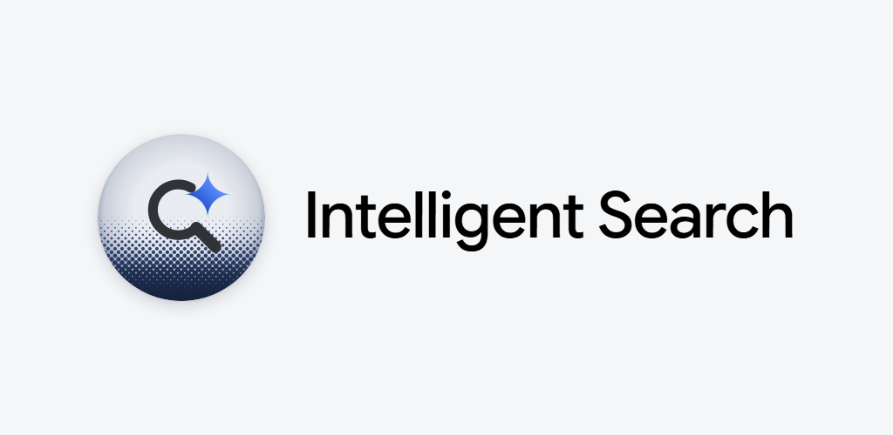

<div align="center">



**Website for [Intelligent Search](https://github.com/Peacetothemountain/Intelligent-Search), by NG Designs**

[](https://intelligentsearchapp.github.io)
[](https://play.google.com/store/apps/details?id=com.pixel.intelligentsearch)

</div>

---

## 🌐 About

The source of [intelligentsearchapp.github.io](https://intelligentsearchapp.github.io), served by GitHub Pages from the
root of `main`. It is plain HTML and CSS: no build step, no JavaScript, no cookies, no analytics. The only outside
request is the Google Sans Flex font from Google Fonts.

The site also publishes the app's **Digital Asset Links** file, which lets Android link the app to this domain for
passkeys and sign-in.

## 📁 Layout

| Path | What it is |
| --- | --- |
| `index.html` | Home page: overview, screenshots, features, privacy summary |
| `privacy.html` | The app's privacy policy |
| `404.html` | Page shown for any missing path (links are root-absolute) |
| `assets/styles.css` | Material 3 Expressive styles, light and dark |
| `assets/` | Logo, icons, Open Graph image, banner and screenshots |
| `.well-known/assetlinks.json` | Digital Asset Links for `com.pixel.intelligentsearch` |
| `.nojekyll` | Serves files as they are, so `.well-known` is published |

## ✅ Checking the asset links

After publishing, these should return the JSON file and a positive result:

```
https://intelligentsearchapp.github.io/.well-known/assetlinks.json
https://digitalassetlinks.googleapis.com/v1/statements:list?source.web.site=https://intelligentsearchapp.github.io&relation=delegate_permission/common.get_login_creds
```

The fingerprint in `assetlinks.json` must match the app signing key shown in Play Console (Setup, App signing).

## ✏️ Updating

- **Privacy policy:** keep `privacy.html` in step with `PRIVACY_POLICY.md` in the app repository.
- **Screenshots:** `assets/screenshots/` holds a `.webp` for the site and a `.png` for README files.

---

<div align="center"><sub>Copyright (c) 2026 <b>NG Designs</b>. Intelligent Search is not affiliated with Google LLC.</sub></div>
